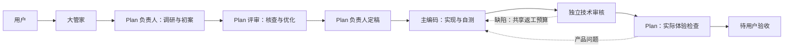

# Workflour：多 Agent 项目协作工作流

在 OpenMausBot 工作台把任务交给大管家，由 Plan Team 制定和评审方案、Code Team 实现和独立审查，最后由 Plan 检查实际体验，交给用户验收。DSH 是 Agent 运行时，WorkBuddy 是模型和额度插件；Gemini 通过独立 Antigravity 运行。

**当前基线：2026-11-11，Mac 已完成技术验证，Windows 尚待在目标电脑移植和验收。** 这份仓库包含源码、职责和技能、模板、重要工作记录与 Windows 交接。它不包含账号登录状态，也不是已验证的 Windows 一键安装器。

## 接手从这里开始

1. [当前完成情况与缺陷](docs/CURRENT-STATUS.zh-CN.md)：先确认哪些已经做过、哪些没有。
2. [项目大纲与实施顺序](docs/PROJECT-OUTLINE.zh-CN.md)：理解架构和关键约束。
3. [Windows 部署手册](docs/windows-deployment/00-从这里开始.md)：软件下载、插件安装、移植和验收。
4. [直接交给 Windows Agent 的任务](docs/windows-deployment/08-Windows-Agent接手提示词.md)：复制全文给新电脑上的 Agent。
5. [重要工作记录](docs/project-records/README.md)：需求、调研、设计、搭建日志、失败原因和有效决策。
6. [日常工作台使用说明](integrations/openmausbot/USER-GUIDE.zh-CN.md)：使用者不需要自己跑初始化终端。

## 编程工作流的七个角色

| Bot | 默认模型 / 思考 | 职责 |
| --- | --- | --- |
| 大管家 | DeepSeek V4.1 Flash / Low | 接收需求、转交、查进度；不自己包办长方案 |
| Plan · 项目负责人 | Kimi K3.1 Pro / High | 调研、初案、定稿、唯一维护共享项目状态 |
| Plan · 方案与体验评审 | DeepSeek V4.1 Flash / High | 核查资料、质疑方案、检查实际成品 |
| Code · 主编码 | Gemini 3.8 Flash / High | 完整实现、集成、自测、返修 |
| Code · 独立审核 | GLM-5.3-Flash / High | 独立代码、测试及回归检查 |
| Code · 协作编码 | DeepSeek V4.1 Flash / High | 仅在有独立子任务时加入 |
| 通用助手 | DeepSeek V4.1 Flash / Low | 临时讨论、整理和管理支持 |

模型和角色分开，所有角色可手动选择已接入模型及真实支持的思考档位。默认修改当前任务，显式“设为默认”才影响以后任务；跨运行时创建新会话并带项目交接，不冒充原生上下文无损迁移。



普通小任务只有一位主编码。技术与体验返工共享最多两轮；共享状态由 Plan 负责人更新；测试与审核绑定实际代码快照。用户停止、失败、等待审批须先核对原生回执，不能重复派单。完成技术检查后保持 `acceptance/pending`，Bot 不能代用户确认。

## 小红书图文工作流

**Windows 上的 Ubuntu 桌面虚拟机：[快速接入教程](docs/xhs-ubuntu-handoff.zh-CN.md)**。克隆后运行 `./scripts/xhs-ubuntu.sh install --system-deps`，按教程登录并启动；无需复制Mac环境。

第二套只有采集、思考、写作三个 Agent。向工作台「小红书 · 思考」发主题，它安排一次采集、写短简报，再交 Gemini 成稿和制作图文卡片，最后由用户查看。

新任务默认：DeepSeek V4.1 Flash / Low 采集、MiMo-V2.6-Pro / High 思考、Antigravity Gemini 3.8 Flash / Low 写作。GLM、MiniMax为可选；同一写作Bot另有DSH正文入口，可选GLM，图片仍走Gemini。已在Mac实跑两篇图文与一次局部返工，过程有维护补交和内容瑕疵，不能称稳定无人值守。当前只交付草稿，由用户确认。

Mac 已通过 AGY 1.5.5 原生 print 和已有登录为 Claude 试稿生成两张 896×1200 JPEG，另存为四页1080×1440图文版本并逐张读图。生图默认 print、单次一张、不自动重试、每篇最多两次，使用 `useG1Credits:false` 禁止自动使用额外 credits；精确扣额与图像后台型号未认证。原写作 Bot 已实际调用，但取回图片曾需维护修复，不能称为无人干预；旧稿/旧图/账本保留，成品待用户查看，Ubuntu 未测试。

配置及操作见 [三 Agent 说明](integrations/openmausbot/team-xhs/README.md)、[采集服务](integrations/xiaohongshu/README.md)、[生图集成说明](integrations/xiaohongshu-images/README.md)、[Ubuntu 迁移入口](docs/xhs-ubuntu-handoff.zh-CN.md)；CLI 行为见官方 [headless](https://antigravity.google/docs/cli/headless/) 和 [credits](https://antigravity.google/docs/cli/credits/) 文档。渲染支持独立版本目录和 `image-cover` 排版，保留旧产物；模板信息卡与真实 AI 插图分别记录。

## 额度和每日任务

六个 DSH 角色沿用已接入模型。默认 DeepSeek 按已核实免费线路、国际/国内临期账号、其他 WorkBuddy 额度的顺序选择；明确额度不足后按候选继续，最后才使用已授权的 DeepSeek API。国内账号遵循桌面插件池勾选与排序，国际账号不擅自扩大范围。Kimi/GLM 先按角色默认请求，额度不足才进入备用链。网络断开和排队不当作额度耗尽。

北京时间每天 **13:00** 检查国内账号签到，并在之后的新回合恢复原模型及额度优先规则；运行中回合不打断，手动选模型不覆盖。新电脑必须重新登录并核对实时模型目录、价格和额度；模型名和历史免费促销不能证明当前可用。

详见 [模型与备用](integrations/openmausbot/model-fallback/README.md)、[签到](integrations/openmausbot/workbuddy/README.md)。Antigravity 当前不自动跨运行时备用。

## 目录

| 位置 | 内容 |
| --- | --- |
| `agents/wf-*` | 七角色职责与按需技能；共享技能在 `wf-shared/` |
| `integrations/openmausbot/` | ACP 恢复、模型控制、WorkBuddy、工作台精简层、Mac 托管 |
| `scripts/` | 新项目、阶段账本、回执核对、停止恢复、记录导出及观察器 |
| `templates/` | `plan-code`、旧兼容模板，含必要隐藏脚手架和许可证 |
| `tests/` | 单元测试、协议探针；真实模型探针可能调用额度，应按文档选择 |
| `examples/plan-code-web-demo/` | 已交付“今日三件事”网页源码和产品测试样例 |
| `docs/project-records/` | 可携带的手写工作记录快照；历史不覆盖后续决定 |
| `docs/evidence/2026-11-11/` | 脱敏验证摘要、真实工作台与产品截图 |
| `docs/windows-deployment/` | Windows Agent 的详细安装/移植/验收任务 |

原始会话、账号信息、真实 Bot 部署映射、数据库、依赖缓存和旧业务项目没有上传。完整导出清单和范围见 [仓库内容说明](docs/REPOSITORY-CONTENTS.zh-CN.md)。源文件仍有 Mac 路径和历史兼容入口，Windows Agent 应按适配清单逐项改写，不能照搬真实 UUID 或服务器地址。

## Mac 开发基线

本机入口 `http://127.0.0.1:8799`，后台由 `scripts/omb-public.sh up|down|restart|status` 管理。重启拒绝中断忙碌 Bot。新项目使用：

```sh
python3 scripts/new-project.py /absolute/path/to/new-project --workflow plan-code
```

日常由工作台 Bot 执行项目初始化。新机器不要直接运行旧清理/迁移脚本；它们仅记录本机已执行过的维护过程。

单元测试（目标平台还应解决缺失依赖和平台假设）：

```sh
python3 -m unittest discover -s tests -p 'test_*.py'
node --test tests/test_*.mjs
```

编程团队发布时基线为 Python 165 项（164 通过、1 跳过）、Node 62 通过；完整网页演练包括独立技术审核、44 项真实浏览器检查与 16 张截图，当前待用户验收。过程有维护介入，尚未通过同题对照证明优于单 Agent。小红书首次部署的 Python 回归为196项（1跳过），采集/服务另13项通过；后续生图与版本排版调整有52项针对性测试通过。本套未修改JS，也未重复Node测试。

## 来源与许可

第三方技能和脚手架的来源、许可证、固定版本保存在对应目录。见 [第三方说明](THIRD_PARTY_NOTICES.md) 和 [技能来源清单](integrations/openmausbot/team-v2/sources/manifest.json)。不要将整仓库视为统一获得了某种开源许可证。
