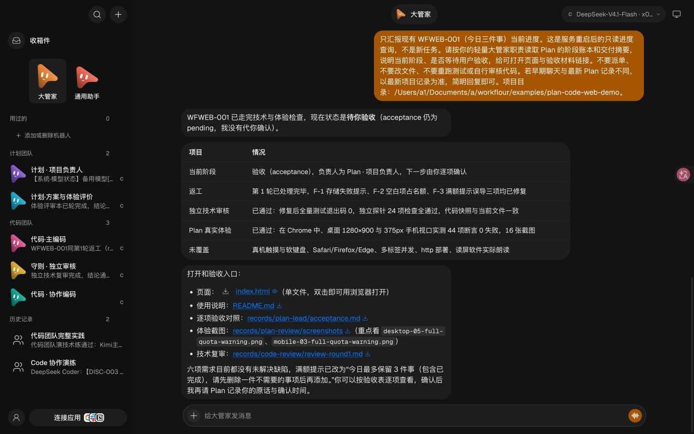

# Workflour 当前状态与事实验收

快照日期：2026-11-11，Asia/Shanghai。验证环境：原 Mac。**新七角色与精简工作台已上线，真实网页演练完成技术与体验检查，仍待用户验收；Windows 版本尚未部署验收。**

本页汇总现有文件和已完成检查，不表示在写文档时又执行了一轮模型请求或全量测试。总机器可读摘要见 [final-summary.json](evidence/2026-11-11/final-summary.json)，接手架构见 [项目大纲](PROJECT-OUTLINE.zh-CN.md)。仓库只保留筛选后的验证摘要与图片，原始运行记录不整批上传。

## 当前有效配置

| 范围 | 已核实状态 | 依据 |
| --- | --- | --- |
| 团队 | 七个业务角色：大管家、Plan 负责人、Plan 方案/体验评审、主编码、独立审核、按需协作编码、通用助手 | [角色声明](../integrations/openmausbot/team-v2/roles.json)、[已上线状态摘要](evidence/2026-11-11/final-summary.json) |
| 执行层 | 六个 DSH profile 加一个独立 Antigravity 运行时；WorkBuddy 只是模型/额度插件通道 | [能力说明](../agents/wf-shared/CAPABILITIES.md) |
| 协作流程 | 大管家转交；Plan 负责人唯一维护共享状态；小任务单主编码；独立技术审核后再做实际体验 | [流程规范](../integrations/openmausbot/PLAN-CODE-WORKFLOW.md) |
| 模型控制 | 角色不绑定模型；当前任务与 Bot 默认分开；跨运行时建新会话读交接 | [模型控制边界](../integrations/openmausbot/MODEL-CONTROLS.md) |
| 工作台 | OMB 0.1.143，同一后端与数据，项目私有 v4 前端精简层已启用 | [工作台实现](../integrations/openmausbot/workbench/README.md)、[v4 实服 QA](evidence/2026-11-11/final-live-v4-qa.json) |
| 每日边界 | 签到与模型恢复均为北京时间 **13:00**，覆盖旧 08:00 约定；执行中回合不打断 | [当前状态摘要](evidence/2026-11-11/final-summary.json)、[备用说明](../integrations/openmausbot/model-fallback/README.md) |

默认分配为：大管家与通用助手 DeepSeek Flash / Low，Plan 负责人 Kimi Pro / High，Plan 评审和协作编码 DeepSeek Flash / High，独立审核 GLM Flash / High，主编码 Gemini Flash / High。具体模型 ID 以 roles.json 和目标机实时目录为准；默认不覆盖用户以后手动选择。

## 已完成且有证据的检查

| 检查 | 真实结果与范围 |
| --- | --- |
| Python 工具包回归 | 共 **165 项，164 通过、1 跳过**。不是 165 项全部通过；跳过项不能当作目标平台支持证明。数字见总摘要及原测试记录 |
| Node 回归 | **62 项通过，0 失败、0 跳过**；包含额度分类、手动选择、13 点边界、签到幂等与锁等 |
| 七角色能力 | 各角色实际完成文件/命令探针；不是只有 ACP 握手。运行时/模型/思考档位以筛选后的请求 metadata 和 ACP 确认为证据，不是独立上游身份认证或余额证明 |
| 网页全流程 | `WFWEB-001`“今日三件事”：调研、方案评审、定稿、单主编码、独立审核、一轮返工、Plan 实际体验、待验收回传均完成 |
| 独立审核 | 修后独立探针 **24 项检查通过**，当前代码快照一致。审核报告曾写 21 项，属于计数笔误，采用实际输出 24 项 |
| 真实体验 | **44 项检查、0 失败、16 张截图**；Chrome 桌面 1280×900 与 375px 手机视口。含坏数据、写入失败、满额文案、键盘与焦点等 |
| 运行中补充 | 真实第二回执在同工作会话串行执行；Plan 负责人登记 supplement 后等待全部 completed，才开始复审；保留原 token、主回执和返工轮数 |
| 重启后进度查询 | 大管家读取现有项目后正确报告待验收；**0 新专业派单**，默认模型与项目文件 hash 未变。用户查询本身的一条根回执不是重复派单 |
| 自动记录 | 新演练七个会话自动导出，0 错误；五个旧登记已按迁移/原有失效原因暂停，旧笔记保留 |
| v4 实服界面 | 1440×900 七入口及待验收回复可见；AI 说明只保留在 AI 页，切到通用/设备/用量无残留；高级设置、配对、用量和安全模型卡可达，未提交设置或新任务 |

主要证据：[E2E 摘要](evidence/2026-11-11/e2e-summary.json)、[补充回执实际衔接摘要](evidence/2026-11-11/supplement-summary.json)、[重启后状态核对摘要](evidence/2026-11-11/final-manager-status.json)、[观察器读回摘要](evidence/2026-11-11/final-observer.json)。这些历史证据不应在 Windows 被当作本机已通过。

这是实际已登录 Chrome 截图；浏览器自动翻译改写了部分可见角色字样，服务器的 Bot 名称未被修改。v3 完成过桌面/375px 的深浅色检查；v4 完成针对切页修复的实服回归及八组离线渲染，**没有重新做 v4 全套手机实机验收**。本次也没有为了看停止按钮而新派任务或实际执行停止。

## 旧团队迁移

旧团队先做可读导出：覆盖 13 个 Bot、78 个会话、3720 条消息；其中系统默认 Bot 保留隐藏，**12 个旧业务 Bot 已删除**。新七角色和它们的探针不属于旧导出。七条新角色能力探针已可逆归档，两个旧群的历史入口保留。

八个旧项目未删除，也未代签验收；六个待用户验收，两个账本仍在需求阶段。其中规划讨论演练已经做完讨论，不能称为完全没开始。删除前后核对的 134 个受保护项目文件 hash 一致。仓库可读核对结果见 [迁移摘要](evidence/2026-11-11/legacy-migration-summary.json)；导出实现见 [export-team.py](../scripts/export-team.py)。

完整旧聊天、工作区附件和恢复备份留在原机私有备份目录，不应上传到学习仓库。Windows 不复用旧 Bot ID、会话游标或正在执行的账本。用户明确续办旧项目时，在新团队建立新会话，先读交接、现有代码和证据再决定下一步。

## 额度、签到与恢复的实际边界

已实现顺序为：**新鲜目录确认的免费线路 → 国际/国内临期积分账号 → 其余 WorkBuddy 积分 → 既有 DeepSeek API**。同地区沿用插件原生账号池顺序，临期队首按到期时间比较。国内两个勾选账号继续使用原生池；未擅自启用其他账号。

2026-11-11 的实时国际目录没有返回有效免费 DeepSeek，因此两次真实最小请求使用的是国际临期 DeepSeek 线路，不能写成“免费额度已调用成功”。第二次明确 Low，实际请求也为 Low；正常返回、0 工具调用。内部路由没有进入手动模型菜单。本轮未故意耗尽真实账号，也未在本轮触发最后的付费 API。

两个国内账号读回“当日已经签到”，`claimAttempted:false`，不是本轮新领取；重复检查未再领取。自动化读回为 ACTIVE、13:00；九个会话状态文件可读、0 错误，所有 Bot 默认不变且当时空闲。**尚未等待次日 13:00 自然触发来验证调度器**。

连接失败、排队、配置错误、未知余额都不能直接当作额度用完。手动模型选择优先；模型成功实际返回后才显示确认。只调思考程度时保留新档位，继续同系列额度策略。详见 [WorkBuddy 说明](../integrations/openmausbot/workbuddy/README.md) 和 [额度备用说明](../integrations/openmausbot/model-fallback/README.md)。

## 尚未完成或不能据此宣称完成

- **用户最终验收仍 pending。** 当前网页结果可交付检查，不自动进入 done。
- **本次 E2E 有维护介入。** 维护者收紧了过度能力探针，提供真实文案复现，修复并指导补充回执登记；没有从当前 Codex 直接代派专业 worker。不能称完全无人干预。
- **未做单 Agent 同题对照。** 质量、耗时、额度成本是否更优还没有数据。
- **Windows 尚未部署/实测。** Bash/Ruby 路径、`fcntl` 锁、签到子进程、进程树、symlink、后台托管、DSH 归组均需适配。当前 Mac 测试结果不能替代 Windows 结果。
- **恢复有边界。** 原生 completed 但产物报告 blocked 的情况不满足普通 retry；含 supplement 的失败也不能重跑整个主单。不能保证任意运行中命令无损恢复。
- **权限有边界。** 工作台 Full 不等于 OS 屏幕权限或严格文件沙箱；跨运行时换模创建新任务，不能宣称无损迁移或自动继承原 Full。
- **AGY 没有自动跨运行时额度备用。** DSH 的备用机制不能描述成所有运行时通用。
- **体验覆盖有限。** 未验证真机触摸/软键盘、Safari/Firefox/Edge、多标签并发、网页 HTTP 部署或屏幕阅读器实际朗读。
- **后台依赖原电脑在线和可运行会话。** 睡眠、机器离线或自动化执行环境不可用时不能保证准点工作；已有非空任意仓库一键接管和报告 Agent 也未完成。

下一步：用户验收现有网页，或从大管家发一个真正项目；Windows 接手 Agent 按 [项目大纲的适配顺序](PROJECT-OUTLINE.zh-CN.md#windows-的具体实施顺序) 建立本机证据，不能重放旧派单、补签旧验收或上传账号状态来省略安装步骤。
