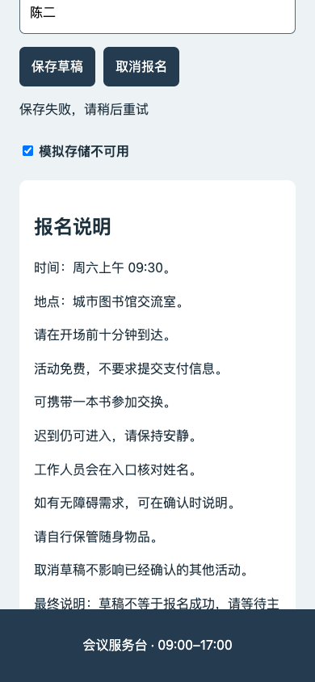
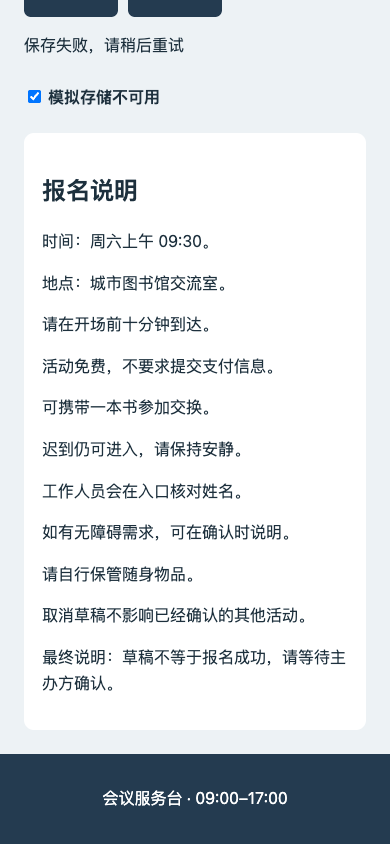

# 七个开发角色：先验证，再决定技能配置

2026-11-12，原 Mac。**本轮没有继续增加技能数量。16项共享方法仍保留文件，12项既有方法按需沿用；新增研究综合收窄触发后启用，另外3项新增方法退回候选。没有证明整套技能优于单 Agent，也没有证明所有默认模型都有效。**

用户中途要求“先用免额度的”，已停止本轮 MiMo/GLM 验证。此后17个验证会话全部使用实时目录确认零倍率的国际 WorkBuddy HY3，不自动回落到扣积分或 API。正式七 Bot 的默认模型、思考档位、Full 权限和项目验收状态未改变。临时替代模型只作用于隔离验证。

## 配置到底怎样工作

角色职责在 `agents/wf-*/SOUL.md` 与该角色自己的 `skills/*-role/SKILL.md`；`SKILLS.md` 是按需路由；共享方法放在 `agents/wf-shared/skills/`。Bot 先保留岗位职责，再按当前问题读取需要的方法和参考。**不是给每个 Bot 常驻加载16份技能。** WorkBuddy 是模型和额度通道，不是另一套工作 Agent。

本轮修改5个角色的按需索引，没有修改共享方法正文来迎合本次题目，也没有安装上游完整插件、增加编排 Agent 或新测试框架。三个候选文件保留用于追溯，未留在新任务的自动选读索引；既有会话可能仍包含旧内容，不能称已经清空历史上下文。

| 角色 | 当前使用方式 |
| --- | --- |
| 大管家 | 保持接单、转交、读进度与模型卡；不加载开发/研究套件 |
| Plan 负责人 | 定向检索、必要澄清、短计划、证据核对；多源冲突或版本/费用适用性不明才读研究综合 |
| Plan 评审 | 易误用设计检查、实际浏览器操作和读图、证据核对；新增 UX 方法暂缓 |
| 主编码 | 保留调试、行为测试、处理审核意见；网页任务才读前端/浏览器方法 |
| 独立审核 | 保留差异或按需求审核与完成证据核对；新增覆盖审核/PBT暂缓 |
| 协作编码 | 只在分配范围内调试、测试和返修；新增 PBT 暂缓 |
| 通用助手 | 检索、冲突资料综合、Obsidian、模型卡；不因资料整理启动团队 |

“既有方法保留”不等于“12项都已充分证明有效”。本轮反而发现既有调试组合与 search-first 也有负效果样例。样本不足以直接归责某个组合内方法，暂不据此删除基础能力。

## 上一轮证据缺在哪里

上一轮14次真实 ACP 尝试确实存在，并非没有运行；但仅5种当前入口 SHA 能匹配当时记录，不能推出16项当前版本均通过。修改后的覆盖审核/PBT缺少对应版本复跑，引用资料没有完整固定；旧基线携带岗位自动指令且必须指定方法，不是干净的无附加方法对照。旧 PBT 的 `sorted(set(...))` 又与 Hypothesis 官方经典例题重合，不能证明处理陌生问题的能力。

本轮把入口、参考包、任务、临时启动器和 overlay 分别留哈希，区分文字正文注入、文件工具读取、目录自动选择和行为结果。路径出现在参数中不等于成功读取，工具 completed 不等于命令退出码0，图片调用 completed 也不等于视觉判断正确。

## 检索扩大到了哪里

先读本地16项方法和角色索引，再分两组阅读实际来源：Plan/UX调查5个独立技能仓库，编码/审核调查7个原始来源，另外核对 W3C、官方评测文档和工具实现。来源、固定提交、许可证、维护情况、依赖、已读文件及限制保留在[Plan/UX调查](research/2026-11-12-skills/plan-ux.md)与[编码/审核调查](research/2026-11-12-skills/code-review.md)。

没有把星数、README 自述或“有评测目录”当成效果证据。例如某候选公开结果实际为空；另一个 UX 检查把 WCAG AAA 项写进 AA 表。gstack/LFG 等完整框架会增加工具和编排职责；Sentry 的迭代 PR 流程会引入提交/评论循环，都没有整套安装。Google 的审核尺度、Hypothesis 的独立性质判断和 Playwright 自动滚动语义可用于校准现有方法，无需再增加同名技能。

## 实际怎样验证

模型拿到合成任务、原始材料与同一输出要求；判据在作答前单独固定，未传给被测会话。每臂使用新会话，无方法组不附加方法。私有 overlay 关闭岗位/AGENTS 加载、默认技能根和额外标题推理，实际进程从仓库外临时目录启动。纯文字筛选没有工具调用；工具题另做文件读取、Python 执行、浏览器与图片检查。文件权限检查只是测试边界，不是严格 OS 沙箱。

匿名复核隐藏方法分组和耗时，由非该题作者审查，工具题另由两人查看实际 PNG、状态和探针。**这不是模型盲评或双盲**；同一 TASK 的子情形也不是独立样本。预备浏览器脚本由维护者提供，不算 Agent 自主搭建浏览器能力。

| 阶段 | 原生会话数 | 结果与使用范围 |
| --- | --- | --- |
| 免费限制前：MiMo/GLM | 23次启动 | 21完成、2随用户要求中止；其中 MiMo 首批7对+大管家单例进入主要文字评审。其余补充和 GLM 不完整对照保留，不凑成胜率 |
| 免费 HY3 文字对照 | 10次 | 5对完成，全部零工具；不把不同模型的两半拼成一对 |
| 免费 HY3 目录触发 | 2次 | CLI帮助和网页单处文案均只改目标内容，未读开发方法文件，未新增文件 |
| 免费 HY3 工具集成 | 4次 | 代码一对、网页一对，均完成；保存实际产物、工具状态及源码不变核对 |
| 免费 HY3 消融 | 1次 | 同一资料题只附既有 writing-plans，检查新增研究方法是否只是重复已有计划字段 |

合计40次启动、38完成、2用户中止。**会话数不是模型 HTTP 请求数**。中止不能记作技能失败，完成也不等于行为通过。运行时 `used/size` 是上下文占用，不能当累计收费 token。

## 观察到的收益和负效果

MiMo 首批7对为当前方法3胜、4持平；HY3的5对为当前方法3胜、2负。下表保留具体问题，不用一个合并分数掩盖差异。

| 案例 | 观察与限制 |
| --- | --- |
| 来源/版本/促销冲突 | MiMo和HY3的研究+计划组都较好：保留Win10硬要求，区别当前本地免费与永久免费。HY3只附 writing-plans 的额外一臂仍把现行免费写成长期保证，提供新增研究方法可能有贡献的单题线索；不证明稳定独立增益 |
| 清楚一致的资料 | 方法组没有实质优势；因此不让普通清楚材料自动加载研究综合 |
| 保存失败、取消、可选扩展/回调 | 覆盖审核两道文字题均持平；无方法组本来已能发现主要缺陷，不能把命中都归功技能 |
| 陌生编解码/性质题 | 两个模型的方法组较好，减少大小端错误和不充分性质的误判；仍只是文字判断，不是实际自动性质测试通过 |
| 调试、审核反馈、旧证据组合 | HY3方法组较差，错误接受截止边界的 ceil 判断，并重复要求已有回归。组合包含4种方法，不能单独归责其中一个 |
| 无Git基线、SDK危险默认值 | HY3方法组合较好；但胜方仍误述部分测试结果，不能称全部正确 |
| 复用已有转换工具 | HY3 search-first 组反而漏掉 `0017→17` 的语义损失；结构/可解析性检查不能代替业务数据保真 |
| Obsidian与边界 | MiMo方法组较好，未从旧自动日志捏造当前完成日期；不是实际知识库自动写入验收 |
| 范围与目录触发 | 文本修复对照持平，两个实际小改没有加载无关方法或扩张范围；不是所有正式会话的全局保证 |
| 大管家转交 | 仅模拟答复，未新派业务单；出现不必要的账本核查倾向。不能替代真实原生委派验证 |

### 工具题没有全部通过

代码题检查浅拷贝导致原输入泄漏。两位复核者都认为新增覆盖审核+PBT组相对较好，也都确认两组有错误：方法组的有界探针提前结束，却宣称性质通过；无方法组的 formatter 文字反例、数值和修复建议不准确。发现真实缺陷不代表其余“通过”都可信。因此这两项继续留候选，未因相对胜出就启用。

网页题两组均识别了手机底部遮挡，且没有把正常取消/保存失败误判为成功。无方法组对刷新后没有界面回显的限制说明更准确；两位评阅的整体结论分别为“无方法较好”和“持平”。方法组出现读回/整体通过和按键覆盖的过度声明。

| 工具题 | 无附加方法 | 当前方法组合 |
| --- | --- | --- |
| 代码 | 111.845秒，7次工具 | 141.636秒，10次工具 |
| 网页 | 146.602秒，20次工具、4次图片调用 | 353.910秒，39次工具、6次图片调用 |

网页方法组期间另有约52秒的小改触发检查并发；基线没有同等负载。因此耗时差不能全部归因技能。工具数是直接观察，不是计费量。每组只有一次，也有维护者脚本和较强任务约束，不能据此宣布某模型普遍更快或技能普遍无效。

以下是该实际工具题的390px截图：第一份页面最终说明被固定底栏遮挡，第二份完整可见。它们只证明这个布局现象，不能证明整个应用通过。

### 执行记录的缺口也保留

原生 DSH 将 bash/read/write 的 ACP kind 报为 `other`，匿名打包按 `execute` 筛选曾产生空操作列表。核对原始已脱敏事件后确认 bash completed 确实存在，已补工具名称/状态摘要；**原记录没有保存完整命令和命令退出码，不能追补成原生 exit0**。代码探针另作维护者离线重放：两臂原有4项单测均通过；候选性质循环只到66/324组合，余额断言仅6个净零场景，未覆盖整个网格。候选最终脚本主动退出1，不能称该版本发生未捕获断言错误。这些属于事后复核，不冒充原回合证据。

记录器现已支持精确工具名称识别，并明确记录这个限制；普通离线检查为验证器8项、ACP恢复协议24项通过。修改后的识别逻辑没有再发一轮模型请求，不能说它已经重新完成端到端验收。共享方法正文在本轮测试前后保持相同版本。

## 当前决定与后续边界

| 新方法 | 决定 | 理由 |
| --- | --- | --- |
| wf-research-synthesis | **收窄后按需启用** | 多源冲突/版本/费用适用性问题有小样本正向信号；清楚单来源不加载。未证明默认Kimi或真实网页检索全过程有效 |
| wf-ux-critique | **候选** | 工具组未证明质量改善，且有额外操作和过度通过声明 |
| wf-test-coverage-review | **候选** | 文字题持平；执行组仍混淆探针证据与通过结论 |
| wf-property-based-testing | **候选** | 文字题有价值，但真实执行的性质范围和声明尚不可靠 |

候选以后若修改，应固定新版本、用不同输入和负对照重新验证，不能改完方法就重做同题报“通过”。本轮公开样例已是开发集，不能再称未见过的留出集。不会为了补结论擅自开启付费模型；Windows/Ubuntu、Antigravity新版本读图和全链路无人值守能力都需要目标环境自己的证据。

## 免费使用边界与交接

HY3与HY4free的2026-11-12实际目录显示零倍率，国际HY3配置允许图片输入且支持Low/High。本轮只用HY3。目录标明每日免费活动到11月15日，**不是永久、无限免费保证**。私有保护在每次模型请求前刷新可用国际账号的目录，必须全部确认目标HY3有效零倍率；不明确、非零或请求模型不符就中止，没有付费备用插件。记录中所有放行均为0倍率；未独立取得逐笔账单，所以不虚报精确扣费为0。

机器可读结果、方法哈希和配置状态见[复验摘要](evidence/2026-11-12/skills-revalidation-summary.json)。原始会话、账号配置、未公开判据和可逆备份留在本机被忽略的证据目录。公开[合成输入](../tests/fixtures/skills-revalidation/README.md)与[验证器](../tests/skills-specialization-live.py)供后续移植，不能照抄私有Mac路径或沿用历史免费价格。
