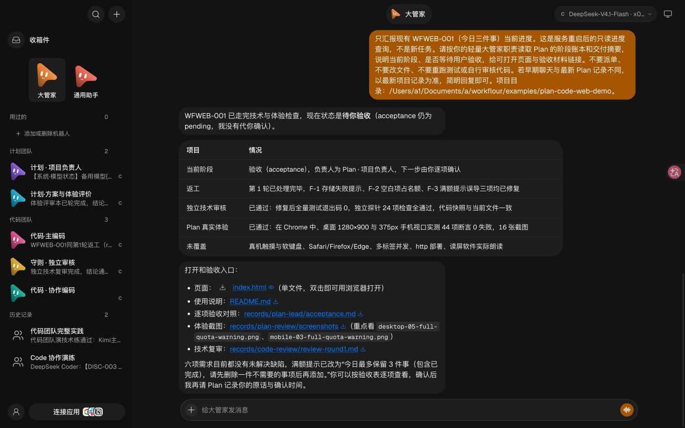
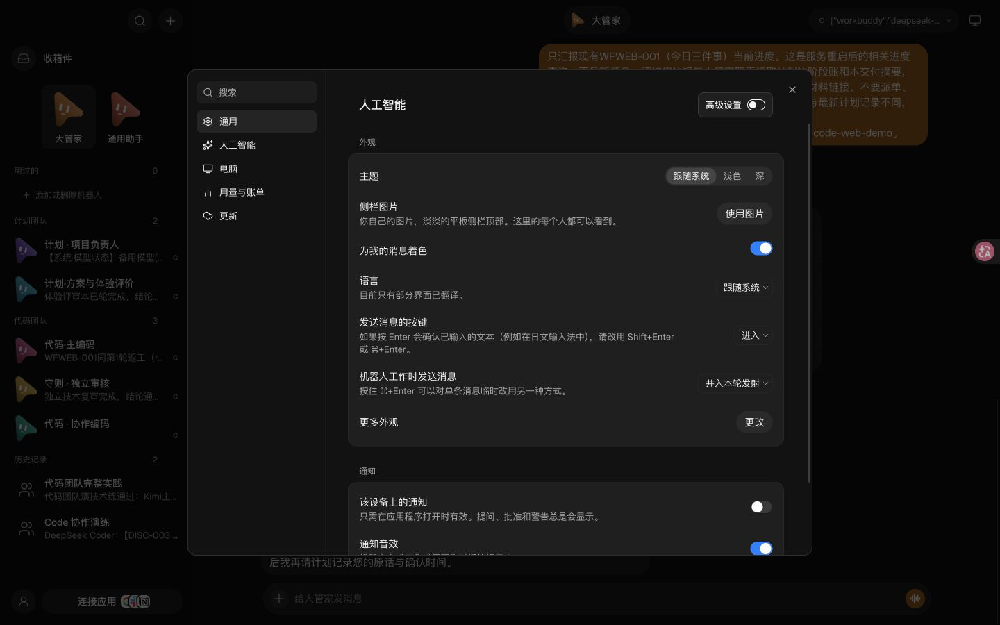
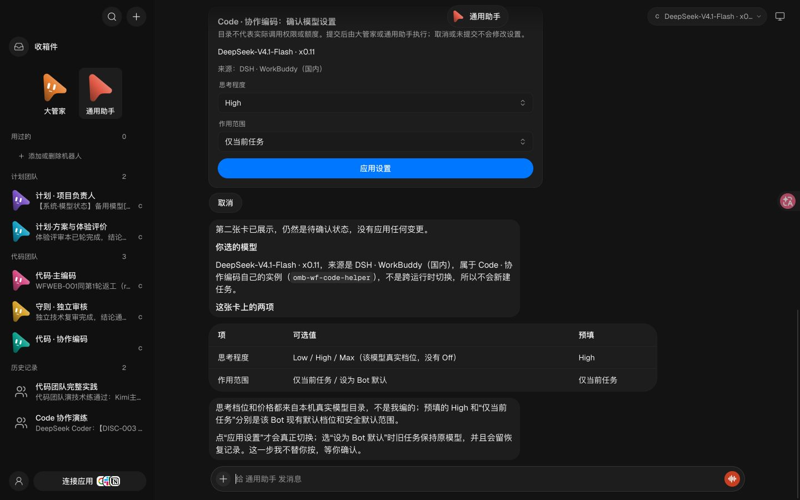

# 2026-11-11 实施与验证摘要

这些材料来自实际 Mac 部署与演练，导出时删除了账号标识、余额、原始会话和私有运行路径。它们用于理解实现及已踩过的问题，不是 Windows 已验收的证明。

| 材料 | 说明 |
| --- | --- |
| [最终摘要](final-summary.json) | 七角色、精简界面、旧记录清理、测试数量与边界 |
| [网页全流程](e2e-summary.json) | 一轮返工，44 项实际浏览器检查，16 张截图，待用户验收 |
| [串行补充回执](supplement-summary.json) | 必须等待主回执与补充回执都完成再审核，不重复派单 |
| [重启后大管家查询](final-manager-status.json) | 只读查进度，没有新专业派单，项目哈希与默认模型不变 |
| [自动记录](final-observer.json) | 七会话导出正常，旧项目显式暂停且保留历史 |
| [旧团队迁移](legacy-migration-summary.json) | 导出后删除旧入口，项目与历史仍保留 |
| [真实额度线路](billing-live-summary.json) | 国际临期 DeepSeek、Low、正常返回、0 工具调用 |
| [签到读回](checkin-summary.json) | 两个国内账号均已签到，本轮没有重复领取 |
| [工作台实服检查](final-live-v4-qa.json) | 第四版真实切页、高级设置与模型卡检查 |

截图是已登录 Chrome 实际画面，自动翻译使部分 Plan/Code 名称显示成中文近义词；服务器角色名没有变。

网页成品的 [16 张桌面与手机截图](product-screenshots/) 与 [源码](../../../examples/plan-code-web-demo/index.html) 一并保留。模型请求正常结束不代表项目质量通过，技术与体验通过也不代表用户已验收。

本轮未故意耗尽真实账号来测试整条付费备用链；这部分采用离线错误注入测试。没有等待次日 13:00 的自动化自然触发。严格文件沙箱、AGY 自动跨运行时备用、单 Agent 对照仍未覆盖。

## 发布前干净检出核对

从Git暂存内容单独检出，确认没有依赖原Mac私有profile、运行账本或依赖缓存才能通过单元测试。macOS上Python165项（164通过、1跳过）、Node62项通过；27个技能链接目标齐全。见[干净检出测试](repository-checkout-tests.json)。这不是Windows实机测试。

